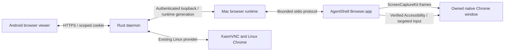

# Native Chrome on macOS

The Mac provider runs Google Chrome on macOS and captures its owned window with
ScreenCaptureKit. The existing Linux provider continues to use KasmVNC. Both
providers use the same authenticated browser API and Android controls.



## Build and install

Install Xcode Command Line Tools and Homebrew, then run as your normal Mac user:

```sh
./install.sh --with-browser native-macos --browser-origin https://your-trusted-host:4443
./start.sh status
```

The origin must use HTTPS trusted by the phone. Supply a trusted certificate
pair with `AGENTSHELL_TLS_CERT_PATH` and `AGENTSHELL_TLS_KEY_PATH`, or use an
existing HTTPS reverse proxy. The runtime token, Chrome profile, session ID
and private browser secret persist across upgrades.

Open the local permission setup:

```sh
open "$HOME/Library/Application Support/AgentShell/browser/AgentShellBrowser.app" --args \
  --config "$HOME/Library/Application Support/AgentShell/browser/browser.json" --setup
```

Grant Screen Recording and Accessibility to AgentShell Browser. Permission
checks also work without requesting access:

```sh
"$HOME/Library/Application Support/AgentShell/browser/AgentShellBrowser.app/Contents/MacOS/AgentShellBrowser" --check
```

For a separate helper build, including a universal app bundle:

```sh
scripts/build-macos-browser.sh --output build/AgentShellBrowser.app --arch universal
```

The build signs the local bundle; `--identity` accepts a configured signing
identity for distribution. Compilation and permission setup do not require
copying a personal Chrome profile. The provider uses a persistent AgentShell
profile on the Mac, with Chrome's native macOS credential storage.

## Browser lifetime and handoff

Starting the browser creates or resumes the verified owned Chrome instance.
Phone/desktop handoffs pause or resume capture of that same instance. Stopping
streaming releases pressed keys and buttons and keeps Chrome open. Tabs,
cookies, authentication and unsaved page state remain in the same browser.
macOS authentication prompts are completed locally through desktop handoff.

The helper verifies the physical Chrome executable, private profile argument,
PID birth time and selected window before capture or input. A closed window,
changed process or missing permission stops delivery. Ambiguous windows are
reported for resolution rather than selected by recency. The current surface
is the main Chrome window; child/XPC dialogs require desktop interaction.

Frames are bounded to six megapixels and eight MiB, with one latest frame
waiting for decoding. The viewer fits the actual captured dimensions. Content
size requests first resize the native window. When macOS clamps its size,
Chrome page zoom supplies the requested content-density adjustment. Opening
the phone keyboard crops the viewer without shrinking the browser.

Ordinary text uses targeted Unicode keyboard events. Dictation uses an explicit
paste ID and waits for the helper's receipt. Reconnects do not replay input.
Unconfirmed typing remains available for review/copy; an interrupted dictation
paste remains in the Android transcript controls. A helper restart retires its
runtime identity, including its in-memory receipt namespace.

## Trust boundaries

The Swift helper has no public network listener. The Python runtime listens on
loopback, checks the private credential and exact Origin, and admits one
generation-pinned viewer. The Rust daemon retains single-use grants,
HttpOnly/Secure cookies, origin checks, controller leases and handoff revocation.
Native assets have their own restrictive CSP. Authentication secrets do not
enter the viewer JavaScript.

## Validation

CI builds the Rust daemon and Swift helper on Apple Silicon and Intel Macs.
It exercises process identity, real owned tmux/PTY sessions, synthetic native
Codex/Claude conversations, installer rollback, and headless helper logic.
Linux remains a separate build and regression target.

```sh
python3 scripts/test_browser_runtime_macos.py
node scripts/test_macos_viewer.js
python3 scripts/test_native_chat_platform.py --binary backend-rust/target/release/agentshell-backend --output /tmp/agentshell-native-chat-check
```

Protocol tests use a fake helper with real loopback WebSockets to check
permissions, ownership changes, handoffs, receipts and bounded frame queues.
Live pixels, focus, coordinate mapping and GUI dialogs still need an interactive
permission-enabled Mac validation; headless CI results do not certify those.

The native APIs follow Apple's [ScreenCaptureKit documentation](https://developer.apple.com/documentation/screencapturekit)
and [window-filter API](https://developer.apple.com/documentation/screencapturekit/sccontentfilter/init%28desktopindependentwindow%3A%29).
Background startup follows [launchd's process-group behavior](https://github.com/apple-oss-distributions/launchd/blob/main/man/launchd.plist.5).
